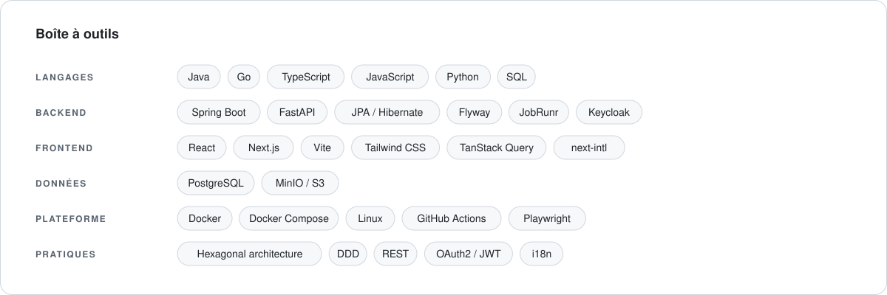
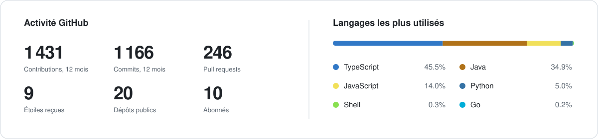
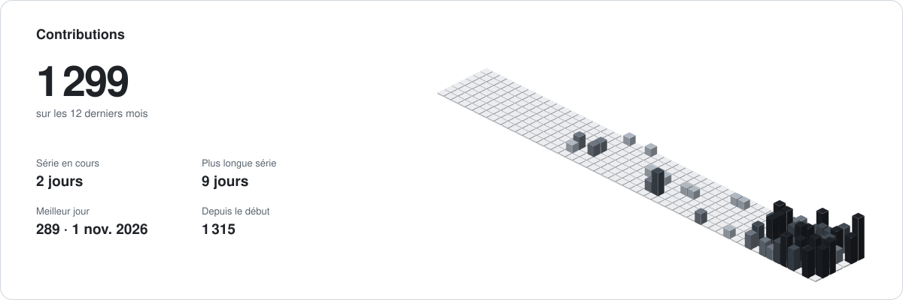

<a href="README.md">English</a> · <b>Français</b>

<picture>
  <source media="(prefers-color-scheme: dark)" srcset="assets/header-fr-dark.svg">
  
</picture>

  
  
  
  
  
  

## À propos

Je suis **Brandon Duclerc Tamwa Kamga**, ingénieur logiciel basé à Yaoundé, au Cameroun. Je construis des systèmes backend et les plateformes qui les entourent : modélisation métier, API, tâches de fond, authentification, stockage, conteneurs et livraison.

L'essentiel de mon travail, ce sont des produits complets, utilisés par de vraies personnes et maintenus dans la durée, pas des démos. Je tiens à des frontières claires, à une infrastructure sans surprise et à un code qu'un nouveau collègue lance en une seule commande.

## Ma façon de construire

- **Le métier d'abord.** Architecture hexagonale et DDD côté backend, pour que les règles métier ne dépendent d'aucun framework.
- **Une seule commande pour lancer.** Chaque projet démarre en local avec `docker compose up`, sans fichier de configuration à écrire.
- **Livré, pas seulement codé.** Versions publiées, migrations, tâches de fond et contrôles de santé font partie du travail.
- **Bilingue par défaut.** Les produits que je construis pour ma région sortent en français et en anglais.

<picture>
  <source media="(prefers-color-scheme: dark)" srcset="assets/toolbox-fr-dark.svg">
  
</picture>

## Activité

<picture>
  <source media="(prefers-color-scheme: dark)" srcset="https://raw.githubusercontent.com/brandonkamga237/brandonkamga237/output/overview-fr-dark.svg">
  
</picture>

<picture>
  <source media="(prefers-color-scheme: dark)" srcset="https://raw.githubusercontent.com/brandonkamga237/brandonkamga237/output/contrib-fr-dark.svg">
  
</picture>

## Derniers articles

<!-- WRITING:START -->
- [Démystifier le dossier .git : Le cœur du suivi de version de Git](https://dev.to/brandoniscoding-dev/demystifier-le-dossier-git-le-coeur-du-suivi-de-version-de-git-i5j) · 4 min de lecture
- [Everything You Need to Know About Generics in Java](https://dev.to/brandoniscoding-dev/everything-you-need-to-know-about-generics-in-java-4igc) · 3 min de lecture
- [Gestion des Exceptions en Java : Guide Complet](https://dev.to/brandoniscoding-dev/gestion-des-exceptions-en-java-guide-complet-2b4l) · 10 min de lecture
- [Introduction à la Gestion des Données en Java : Cas d'Utilisation avec Spring et MySQL](https://dev.to/brandoniscoding-dev/introduction-a-la-gestion-des-donnees-en-java-cas-dutilisation-avec-spring-et-mysql-1bn0) · 16 min de lecture
<!-- WRITING:END -->

  

---

Un poste, un projet ou une idée ? <a href="https://www.linkedin.com/in/brandon-kamga-b9a55b436/">Écris-moi sur LinkedIn</a>.

