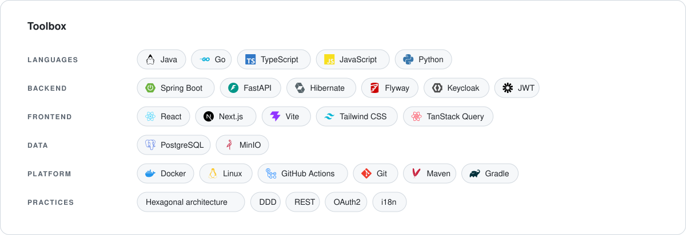
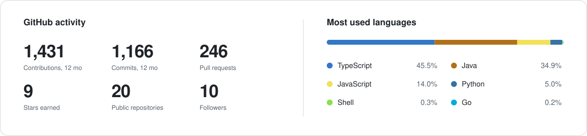
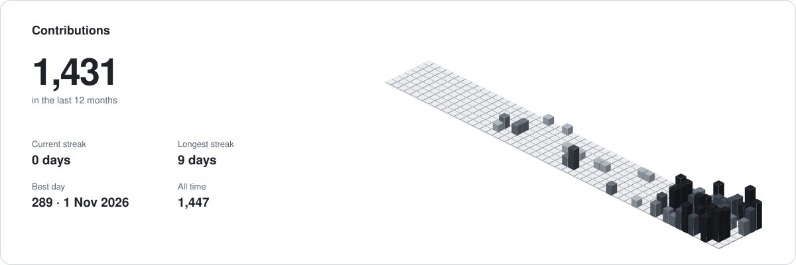

<b>English</b> · <a href="README.fr.md">Français</a>

<picture>
  <source media="(prefers-color-scheme: dark)" srcset="assets/header-en-dark.svg">
  
</picture>

  
  
  
  
  
  

## About

I'm **Brandon Duclerc Tamwa Kamga**, a software engineer based in Yaoundé, Cameroon. I build backend systems and the platforms around them: domain modelling, APIs, background jobs, auth, storage, containers and delivery.

I'm also the founder of **[LesCracks](https://lescracks.com)**, a platform where I share what I know, train young people and push them to innovate by keeping them informed about tech: articles, trainings, events, hackathons and the LesCracks Talk.

Most of my work is full products, used by real people and maintained over time rather than demos. I care about clean boundaries, boring infrastructure, and a codebase a new teammate can run in one command.

## How I build

- **Domain first.** Hexagonal architecture and DDD on the backend, so business rules don't depend on frameworks.
- **One command to run.** Every project starts locally with `docker compose up` and no config file to write.
- **Shipped, not just written.** Versioned releases, migrations, background jobs and health checks are part of the work.
- **Bilingual by default.** Products I build for my region ship in French and English.

<picture>
  <source media="(prefers-color-scheme: dark)" srcset="assets/toolbox-en-dark.svg">
  
</picture>

## Activity

<picture>
  <source media="(prefers-color-scheme: dark)" srcset="https://raw.githubusercontent.com/brandonkamga237/brandonkamga237/output/overview-en-dark.svg">
  
</picture>

<picture>
  <source media="(prefers-color-scheme: dark)" srcset="https://raw.githubusercontent.com/brandonkamga237/brandonkamga237/output/contrib-en-dark.svg">
  
</picture>

## Latest on LesCracks

I write in French on the [LesCracks blog](https://lescracks.com/blog).

<!-- WRITING:START -->
<table>
  <tr>
    <td width="50%" valign="top">
       
      <b><a href="https://lescracks.com/blog/le-singleton-en-java-six-implementations-leurs-pieges-et-leurs-garanties">Le Singleton en Java : six implémentations, leurs pièges et leurs garanties</a></b> 
      Architecture &amp; qualité · 23 min read · 10 Oct 2026
    </td>
    <td width="50%" valign="top">
       
      <b><a href="https://lescracks.com/blog/comprendre-et-construire-un-serveur-web-from-scratch-partie-1-kross-ouvre-la-porte">Comprendre et construire un serveur web from scratch, partie 1 : accepter des connexions</a></b> 
      Fondamentaux &amp; langages · 17 min read · 10 Oct 2026
    </td>
  </tr>
</table>
<!-- WRITING:END -->

  

---

Have a role, a project or an idea? <a href="https://brandonkamga.com/en#contact">Write to me on brandonkamga.com</a> or <a href="https://www.linkedin.com/in/brandon-kamga-b9a55b436/">on LinkedIn</a>.

