<b>English</b> · <a href="README.fr.md">Français</a>

<picture>
  <source media="(prefers-color-scheme: dark)" srcset="assets/header-en-dark.svg">
  
</picture>

  
  
  
  
  

## About

I'm **Brandon Duclerc Tamwa Kamga**, a software engineer based in Yaoundé, Cameroon. I build backend systems and the platforms around them: domain modelling, APIs, background jobs, auth, storage, containers and delivery.

Most of my work is full products, used by real people and maintained over time rather than demos. I care about clean boundaries, boring infrastructure, and a codebase a new teammate can run in one command.

## Featured work

<table>
  <tr>
    <td width="50%" valign="top">
      <h3><a href="https://github.com/brandonkamga237/sourcefolio">SourceFolio</a></h3>
      A catalogue of developer portfolios whose source code is public. Authors publish in one click with GitHub sign-in and get feedback, private analytics and an automated health report of their site. French and English.
        
      <b>Java 21 · Spring Boot 4 · Next.js · PostgreSQL · JobRunr · Playwright</b>
    </td>
    <td width="50%" valign="top">
      <h3><a href="https://github.com/brandonkamga237/lescracks-platform">LesCracks</a></h3>
      The platform behind <a href="https://lescracks.com">lescracks.com</a>: tech blog, events and hackathons, member profiles with badges and certificates, and a newsletter. In production, shipped through versioned releases.
        
      <b>Java 21 · Spring Boot 3 · React · TypeScript · PostgreSQL · MinIO</b>
    </td>
  </tr>
  <tr>
    <td width="50%" valign="top">
      <h3><a href="https://github.com/brandonkamga237/ghemit-paltform">Gehmit platform</a></h3>
      Public website and admin back office for <a href="https://gehmit.org">Gehmit</a>, a Cameroonian non-profit that trains young people for careers in tech. Hexagonal, domain-driven backend with Keycloak single sign-on.
        
      <b>Spring Boot · DDD · Keycloak · React 19 · PostgreSQL · MinIO</b>
    </td>
    <td width="50%" valign="top">
      <h3><a href="https://github.com/brandonkamga237/kross">Kross</a></h3>
      A lightweight web server in Go, written directly on top of TCP sockets to understand HTTP from the bytes up. Tested under the race detector.
        
      <b>Go · TCP · HTTP/1.1 · Make</b>
    </td>
  </tr>
  <tr>
    <td width="50%" valign="top">
      <h3><a href="https://github.com/brandonkamga237/TeQizz">TeQizz</a></h3>
      A gamified tech learning platform: timed quizzes and speed-matching games, with community-contributed content and OAuth2 sign-in.
        
      <b>Spring Boot 4 · Hexagonal architecture · React 19 · JWT / OAuth2</b>
    </td>
    <td width="50%" valign="top">
      <h3><a href="https://github.com/brandonkamga237/fortube">ForTube</a></h3>
      A self-hostable video downloader with parallel fragment downloads and live speed, ETA and progress streamed to the browser over SSE.
        
      <b>Python · FastAPI · React 19 · TypeScript · SSE</b>
    </td>
  </tr>
</table>

## How I build

- **Domain first.** Hexagonal architecture and DDD on the backend, so business rules don't depend on frameworks.
- **One command to run.** Every project starts locally with `docker compose up` and no config file to write.
- **Shipped, not just written.** Versioned releases, migrations, background jobs and health checks are part of the work.
- **Bilingual by default.** Products I build for my region ship in French and English.

## Toolbox

<table>
  <tr>
    <td><b>Languages</b></td>
    <td></td>
  </tr>
  <tr>
    <td><b>Backend</b></td>
    <td></td>
  </tr>
  <tr>
    <td><b>Frontend</b></td>
    <td></td>
  </tr>
  <tr>
    <td><b>Platform</b></td>
    <td></td>
  </tr>
</table>

Also: Keycloak, MinIO / S3, Flyway, JobRunr, Playwright, JPA / Hibernate, TanStack Query, next-intl.

## Right now

- Building **SourceFolio** toward its first public release.
- Going deeper on systems fundamentals with **Kross**.
- Growing the **LesCracks** tech community in Cameroon.

---

Have a role, a project or an idea? <a href="https://linkedin.com/in/brandon-duclerc-tamwa-kamga-3546a2291/">Message me on LinkedIn</a>.

